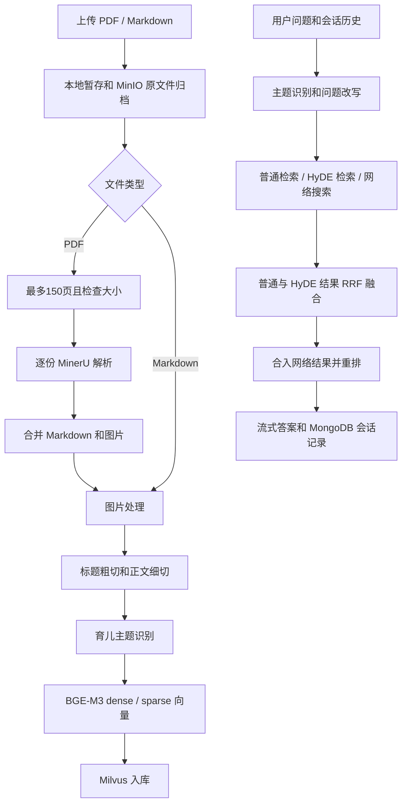

# 育儿知识库 · parenting_kb

基于「掌柜智库」项目进行的第一次育儿场景改编，面向育儿建议、亲子案例、沟通话术和知识科普，完成 PDF / Markdown 导入、检索和对话问答。

**当前版本定位：第一次改编、首次提交基线（2026-10-30）。** 本次先归档已经跑通的学习实践，保留原项目主要技术栈、环境配置方式和工作流；后续会继续提交其他版本。本仓库不是最终版本，也不将已知缺陷描述为已经修复。文中的 `v0.1` 是阶段标识，不代表已经创建 Git 标签或发布 Release。

## 运行效果

### 育儿问答


### 文档导入


本版已在本地跑通大 PDF 自动拆分与解析，用户上传原始 PDF 后无需手动分成多份。上图分别展示育儿问答和 Markdown 导入完成；更多 Milvus / MinIO 截图见 [运行结果归档](docs/run-results.md)。

## 本次改编做了什么

| 方面 | 第一次改编的内容 |
| --- | --- |
| 应用场景 | 从商品知识问答调整为育儿知识问答，资料包含建议、案例、沟通话术及育儿书籍 |
| 提示词 | 调整导入主题识别、会话主题提取、问题改写、HyDE 和答案生成提示词 |
| 兼容原结构 | 保留 `item_name` / `item_names` 等字段名，语义改为育儿主题，减少工作流和数据库接口改动 |
| 多文档导入 | 主体集合仅在不存在时创建；同名文件按 `file_title` 删除旧记录再写入，避免每次导入清空全部主体 |
| PDF 自动拆分 | 后台按最多 150 页拆分，导出后检查大小，超过 180 MiB 则递归拆小；按页序逐份调用 MinerU |
| 解析结果合并 | 各段 Markdown 顺序合并；图片加分段前缀并汇总到 `merged/images`，同步更新标准 Markdown 图片引用 |
| 重排输入 | 将缺失正文 / `None` 归一为空字符串，过滤空字符串后再调用重排模型，按返回下标回填分数 |
| 界面 | 导入页和聊天页调整为暖色调，使用育儿场景文案 |
| 实践记录 | 归档 PDF 切分和空正文 chunk 两个问题的现象、原因、代码路径、验证边界和后续计划 |

现有数据库曾使用 `expand_item_name.py` 将两个集合的 `item_name` 上限调整为 512。**当前建表源码仍分别保留 50 / 100 的初始上限，数据库修改没有自动同步回建表源码。** 新环境请按下文处理，不要误认为首次建表即为 512。

## 技术栈和数据流

Python 3.12+、uv、FastAPI、LangGraph、BGE-M3、Milvus、MongoDB、MinIO、MinerU、DashScope 文本重排，以及 OpenAI 兼容接口的语言 / 视觉模型。依赖以 `pyproject.toml` 和 `uv.lock` 为准。



Milvus 的 dense / sparse 混合检索与后续 RRF 是不同层次的融合；网络结果在重排节点合入候选。没有足够主题信息时，查询图也可能直接进入答案节点。

## 项目结构

```text
parenting_kb/
├─ atguigu/
│  ├─ config/                 # 环境配置读取、育儿提示词
│  ├─ import_process/         # 导入工作流、PDF 解析、图片和切分节点
│  ├─ query_process/          # 查询、召回、融合、重排和答案节点
│  ├─ tool/                   # PDF 拆分、向量、数据库、任务状态工具
│  └─ web/
│     ├─ service/             # 导入服务 8000、查询服务 8001
│     └─ pages/               # import.html、chat.html
├─ docs/
│  ├─ troubleshooting.md      # 两个问题的完整复盘
│  ├─ run-results.md          # 六张截图与证据说明
│  └─ images/v0.1/            # 第一次改编的实跑截图
├─ .env.example              # 无真实凭据的配置模板
├─ expand_item_name.py       # 已有集合的字段扩容脚本
├─ main.py                   # 环境 / Milvus 连通性演示，不是 Web 启动入口
├─ pyproject.toml
├─ uv.lock
└─ CHANGELOG.md
```

## 本地运行（Windows / PowerShell）

### 1. 准备环境

```powershell
git clone https://github.com/XUYINGLAI/parenting_kb.git
cd parenting_kb
uv sync --locked
Copy-Item .env.example .env
```

编辑 `.env`，填入自己的服务地址、模型名称、模型本地路径和凭据。`.env.example` 只是模板，不能直接用于真实模型调用。不要复制旧项目的 `.venv`；在新目录用锁文件重建环境。

原项目的包元数据 `name = "test111"` 本次保留，以减少环境变化；仓库名和产品名是 `parenting_kb` / 育儿知识库。首次运行需要可访问的模型服务、MinerU Token、Milvus、MongoDB、MinIO 和本地 BGE-M3 模型，仓库不包含这些外部服务、权重或数据库快照。

| 配置组 | 用途 |
| --- | --- |
| `MINERU_TOKEN` | PDF 在线解析 |
| `OPENAI_API_KEY`、`OPENAI_API_BASE` | 语言 / 视觉模型接口 |
| `LLM_DEFAULT_MODEL`、`ITEM_MODEL`、`VL_MODEL` | 答案、主题识别和图片理解模型 |
| `LLM_DEFAULT_TEMPERATURE` | 生成温度，必须填写有效数字 |
| `BGE_M3_PATH`、`BGE_DEVICE`、`BGE_FP16` | 本地向量模型、设备和精度 |
| `MILVUS_URL`、`CHUNKS_COLLECTION`、`ITEM_NAME_COLLECTION` | 向量库和两个集合 |
| `MINIO_*` | 原文件与图片归档；需事先创建对应桶，图片链接需可访问 |
| `MONGO_*` | 聊天历史；`MONGO_PORT` 必须为整数 |
| `MCP_BASE_URL`、`MCP_API_KEY` | 当前查询图接入的网络搜索服务 |
| `RERANK_BASE_URL`、`RERANK_API_KEY`、`RERANK_MODEL` | DashScope 重排服务 |

当前配置类在导入时就转换数字，不能简单留空温度和 MongoDB 端口。当前图包含网络搜索分支，暂未提供通过配置关闭该分支的开关。

### 2. 启动两个后端服务

在项目根目录分别打开两个终端：

```powershell
# 终端一：文档导入，端口 8000
uv run --locked python -m atguigu.web.service.import_service
```

```powershell
# 终端二：育儿问答，端口 8001
uv run --locked python -m atguigu.web.service.query_service
```

导入 API 文档：<http://127.0.0.1:8000/docs>；查询 API 文档：<http://127.0.0.1:8001/docs>。

目前上传目录在 `import_service.py` 中设为 `D:\output\日期`，运行前确认目录所在磁盘可写，或手动调整该路径。查询服务 `/health` 返回成功只代表服务在线，不代表模型、向量库等全部业务依赖已经验证成功。

### 3. 打开前端

可用 PyCharm 的浏览器预览分别打开 `atguigu/web/pages/import.html` 与 `chat.html`，也可以在第三个终端运行：

```powershell
uv run --locked python -m http.server 8080 --bind 127.0.0.1 --directory atguigu/web/pages
```

访问 <http://127.0.0.1:8080/import.html> 和 <http://127.0.0.1:8080/chat.html>。静态服务器只暴露页面目录，避免将项目根目录中的 `.env` 暴露给浏览器。前端当前固定连接本机 8000 / 8001 服务。

### 4. 导入资料并提问

先导入一份小 Markdown，确认主题和正文写入，再导入 PDF。PDF 自动拆分发生在后台，前端仍显示一个 PDF 转 Markdown 节点，分段进度在后端日志中查看。

示例问题：`5岁孩子睡前总拖延、反复下床，家长应该怎么做？`

同名文件按 `file_title` 覆盖旧记录；这并不意味着不同路径的同名文件可以自动区分。`main.py` 只是连通性演示，退出码 0 不能代替导入和问答验收。

### 5. 已有集合字段扩容（按需）

若较长的中文主题因 `item_name` 上限导致写入失败，先确认集合已创建并备份，再在支持该字段变更的 Milvus 版本上执行：

```powershell
uv run --locked python expand_item_name.py
```

该脚本会实际修改两个集合中 `item_name` 的字段上限为 512，并打印修改结果；不是纯检查命令。不要把 VARCHAR 上限理解成可容纳相同数量的中文字符，需考虑 UTF-8 字节。

## 两个历史问题与本版处理结果

完整说明见 [PDF 切分与空正文 chunk 复盘](docs/troubleshooting.md)。

| 历史问题 | 本版状态与处理结果 | 后续增强 |
| --- | --- | --- |
| 此前大 PDF 需要人工拆分 | **已解决：支持大 PDF 自动拆分并解析，作者已本地实跑成功。** 上传原文件后，后台按最多 150 页及文件大小自动拆分，逐份解析并合并正文与图片 | 在现有可用流程上增强超时处理、失败恢复和容量管理 |
| 空正文 chunk 进入重排 | 在重排前过滤 `""`，保留过滤后下标对应关系 | 在切分源头过滤、过滤纯空白、处理全部为空、清理库中历史空片段 |

**大 PDF 自动拆分与解析是本版已经跑通的能力，不是待实现功能。** 作者已确认本地运行成功；后续增强项用于提高稳定性和使用体验。归档时额外执行的离线检查见 [检查记录](docs/release-checks.md)。

## 已知边界与后续版本

- 后台拆分解决送给 MinerU 的单份文件约束；不等于用户上传、服务内存、磁盘或总处理时间无限。
- 单份 MinerU 当前轮询预算为 1600 秒，网络请求没有配置显式超时；解析失败终态未单独处理。
- 上传任务状态保存在进程内存，前端任务列表未做持久化恢复；刷新页面不能自动恢复上传卡片，重启进程也会丢失任务状态。
- 切分节点仍可能生成空正文；当前重排过滤没有 `.strip()`，也没有全部为空时的分支和完整响应失败检查。
- 动态 TopK 计算了 `break_idx`，最终却使用 `rerank_chunks[:]`，截断尚未生效；答案提示词整体截取前 10000 字符，长输入可能截掉后面的内容。
- 任务和 SSE 队列为单进程内存结构；当前是学习演示形态，尚未补齐登录鉴权、任务队列持久化、配额及断点续传。
- 建表定义、字段迁移脚本和真实数据库状态仍需统一；部分独立调试样例保留掌柜智库的商品内容，不代表育儿运行链重新变为商品场景。

后续版本将继续记录实际修复、验证结果和行为变化，见 [版本记录](CHANGELOG.md)。

## 资料与来源

项目以掌柜智库学习项目为基础进行场景改编，保留原目录、主要依赖和核心链路，新增育儿场景适配与问题复盘。未确认上游授权条款前，不额外声明整个派生项目采用某一开源许可证。

本仓库仅归档代码、文档和经检查的运行截图；不上传真实 `.env`、API Key、本地虚拟环境、模型权重、原始育儿书籍 PDF、解析 ZIP 或数据库备份。

- [MinerU API 文档](https://mineru.net/apiManage/docs)
- [pypdf 按页范围写入示例](https://pypdf.readthedocs.io/en/stable/user/merging-pdfs.html)
- [阿里云重排序 API](https://help.aliyun.com/zh/model-studio/rerank)
- [DashScope 1.x 调用风格参考](https://help.aliyun.com/zh/model-studio/dashscope-1x-legacy-reference)
