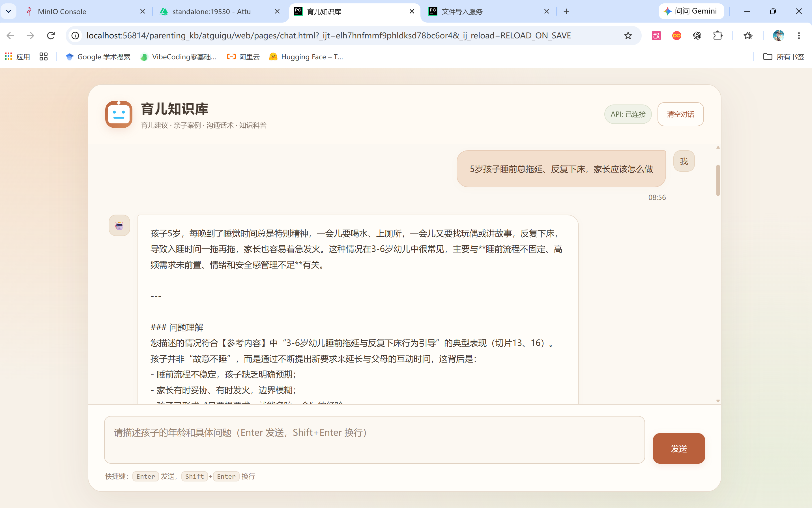
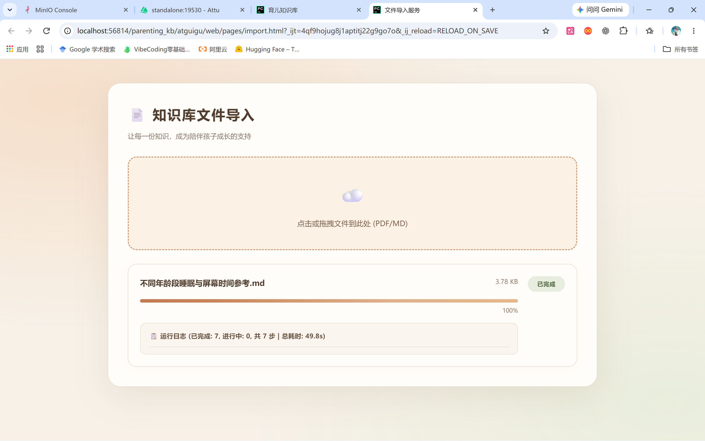
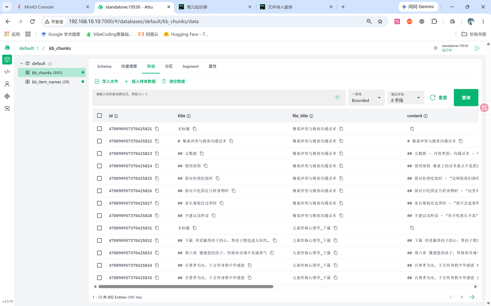
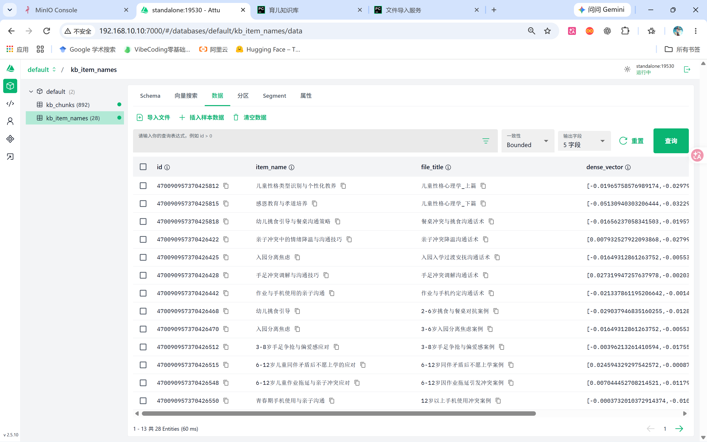
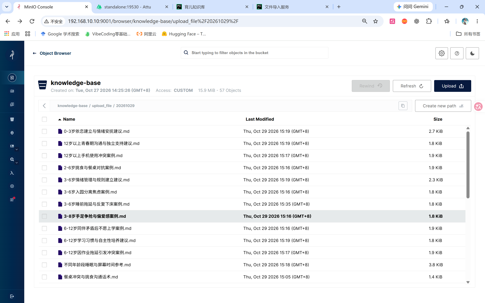
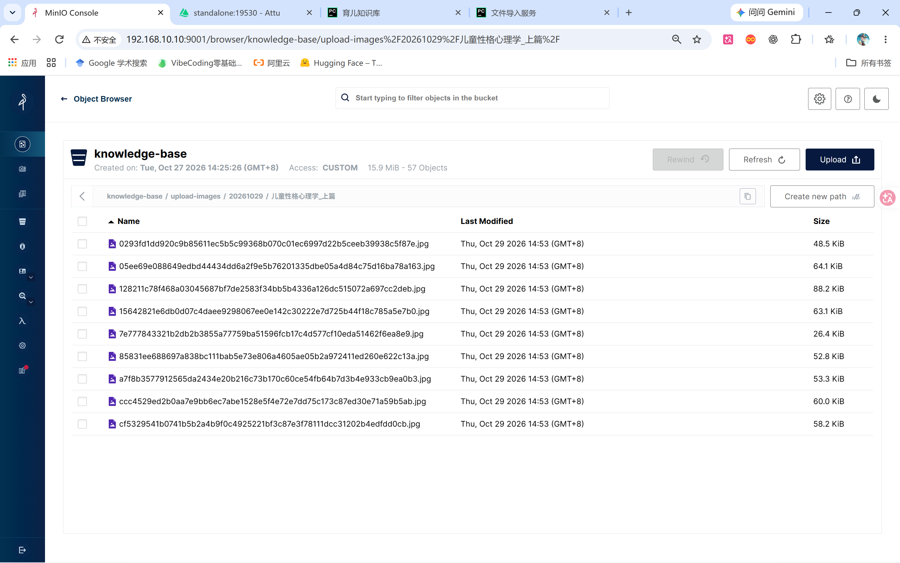

# 第一次改编：本地运行结果归档

阶段：育儿知识库第一次改编（v0.1 阶段标识）；归档日期：2026-10-30。

截图由作者提供，原图保持不变，以便对照当时运行状态。仓库统一复制到 `docs/images/v0.1/`，不移动本地原文件；后续版本可以另建目录保留对比。大 PDF 自动拆分与解析已由作者确认本地实跑成功。下面六张图分别展示问答、Markdown 导入和存储结果，保留各图实际对应的运行阶段。

## 1. 育儿问答

示例问题为「5岁孩子睡前总拖延、反复下床，家长应该怎么做」。可见育儿主题界面、API 已连接以及参考资料相关的回答片段。截图只显示部分答案，不单独证明所有引用、事实性和后续追问都正确。

## 2. Markdown 导入完成

「不同年龄段睡眠与屏幕时间参考.md」显示已完成、进度 100%。此图证明展示时该 Markdown 任务完成，不是 PDF 多段解析的截图。

## 3. Milvus 正文切片

当时 `kb_chunks` 显示 892 条记录，包含标题、原文件标题和正文。图中也可见「无标题 / 空正文」记录，说明数据库还留有历史坏数据；本次只在查询重排前屏蔽空字符串，尚未在切分源头阻断或清理历史数据。详见 [问题复盘](troubleshooting.md)。

## 4. Milvus 育儿主题

当时 `kb_item_names` 显示 28 条记录，主题包括幼儿挑食引导、入园分离焦虑等。字段名仍为 `item_name`，业务语义已经调整为育儿主题。

## 5. MinIO 原始文档

原 Markdown 文档已复制到对象存储。对象存储归档和解析流水线是不同职责，上传归档不等于已经成功解析入库。

## 6. MinIO 图片

书籍解析图片已写入对应对象存储目录。图中目录沿用当时人工拆成上篇 / 下篇的文件名；不能据此推断后加的自动拆分已生成完全相同目录。

## 文件对应表

| 原图名称 | 仓库文件 |
| --- | --- |
| Web_chat.png | images/v0.1/web-chat.png |
| Web_import.png | images/v0.1/web-import.png |
| Milvus_chunks.png | images/v0.1/milvus-chunks.png |
| Milvus_itemnames.png | images/v0.1/milvus-item-names.png |
| Minio_文档.png | images/v0.1/minio-documents.png |
| Minio_图片.png | images/v0.1/minio-images.png |

计数和耗时均为当时画面，不是基准性能测试。图片显示本地地址、资料名称和演示内容，未发现可见 API Key 或密码；图片不包含原始书籍完整内容、数据库导出或模型权重。
